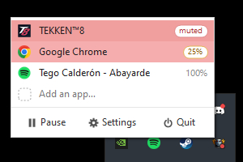

<h1 align="center">
  
  &nbsp;
  muten
</h1>

<p align="center">
  Application audio control for Windows.<br/>
  Automatically mute apps when they lose focus and unmute them when you switch back.
</p>

## Features

- **Auto-mute** — **mutened** apps only play sound when their window is active
- **Background volume** — instead of silencing an app, keep it quieter in the background (set per app)
- **Fade & wait** — smooth volume fades, and a short wait so quick alt-tabs and pop-ups don't cut the sound
- **Pause key** — pause or resume auto-mute from anywhere (default `Ctrl+Alt+M`)
- **Settings window** — manage apps (pick a running app or browse for an `.exe`), notifications, Start with Windows
- **Auto-update** — muten checks GitHub for new releases and installs them in one click
- Settings saved to `%APPDATA%\muten\settings.json`

## Install

Download `muten.zip` from the [latest release](https://github.com/elsergiovera/muten/releases/latest), extract anywhere, and run `muten.exe`.

## How it Works

<p align="center">
  
</p>

1. Click the tray icon to see the apps playing sound
2. Click an app to **muten** it (highlighted)
3. Set its background volume in **Settings**: **muted**, or a lower volume like 25%
4. Alt-tab away → the app goes quiet. Alt-tab back → full volume again

Use **Pause** / **Resume** in the menu (or the pause key) to temporarily disable auto-mute. Open **Settings** to set each app's background volume and tune fade, wait and notifications.

## Settings

Open **Settings** from the tray menu:

| Setting | What it does |
|---|---|
| **Apps** | The **mutened** apps. Add one with **+ Add** (pick a running app or browse for an `.exe`) and set its **volume in the background** (0% = fully muted) |
| **Fade** | How the volume changes when you switch windows: Off, Short or Long |
| **Wait** | A short delay before muting (slider from Off to 1 s, in 0.1 s steps), so quick alt-tabs and pop-ups don't cut the sound |
| **Notifications** | Show a small toast when an app gets **mutened** |
| **Start with Windows** | Launch muten when you sign in |
| **Pause key** | Global shortcut to pause / resume auto-mute (default `Ctrl+Alt+M`) |

muten also checks GitHub for a newer release; when there is one, **Install** in the menu updates and restarts it.

## CLI

A companion CLI is included for one-shot commands:

```bash
dotnet run --project src/muten.Cli -- <command>
```

| Command | Description |
|---|---|
| `muten list` | List all active audio sessions |
| `muten mute <name\|pid>` | Mute an application |
| `muten unmute <name\|pid>` | Unmute an application |
| `muten toggle <name\|pid>` | Toggle mute state |
| `muten volume <name\|pid> <0-100>` | Set volume percentage |

You can target apps by **process name** (case-insensitive) or **PID**.

## Building from Source

Requires Windows 10+ and [.NET 8 SDK](https://dotnet.microsoft.com/download/dotnet/8.0).

```bash
# Run during development
dotnet run --project src/muten.Tray

# Build release zip
build.bat
```

`build.bat` publishes a self-contained single-file exe and packages it into `muten.zip`.

## Releasing

```bash
build.bat 2.0.0                    # produces muten.zip (version defaults to the latest tag)
git add muten.zip
git commit -m "v2.0.0"
git tag v2.0.0
git push && git push --tags        # triggers GitHub Actions
```

Pushing a `v*` tag creates a GitHub Release with `muten.zip` attached and deploys the site.

Pushing to `main` with changes in `src/www/` deploys the site only (no release).

## Project Structure

```
muten/
├── muten.sln
├── build.bat                      # Build + zip script
├── .github/workflows/release.yml  # CI: release + deploy site
└── src/
    ├── assets/                   # Shared icons and images
    ├── muten.Core/               # Core library (shared by CLI and Tray)
    ├── muten.Cli/                # Command-line interface
    ├── muten.Tray/               # System tray application
    └── www/                      # Landing page (Astro)
```

## Tech Stack

- **C# 12 / .NET 8**
- **NAudio 2.2.1** — Windows Core Audio API wrapper
- **Astro** — Landing page at [muten.veraserg.io](https://muten.veraserg.io)
